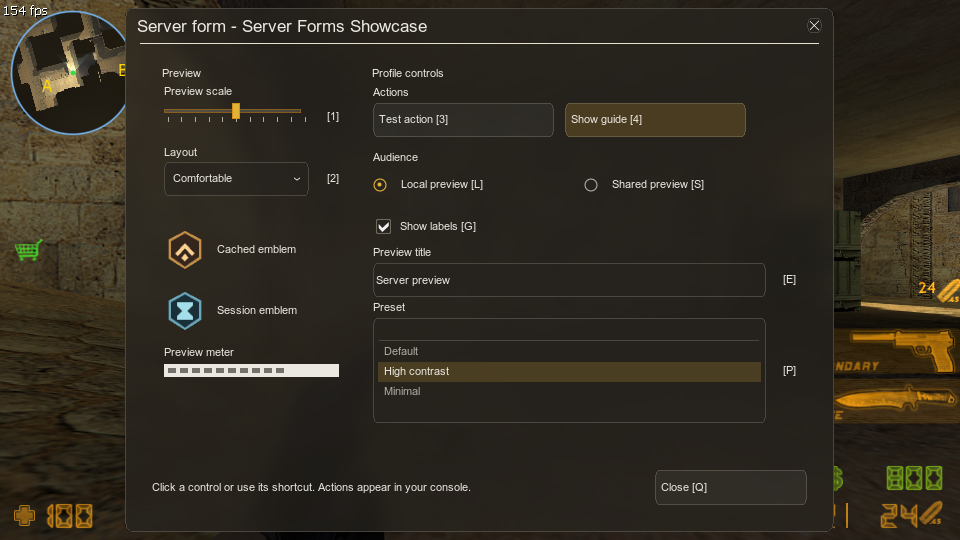

# Server forms

CounterStrikeExtended clients can display native VGUI2 forms provided by a Counter-Strike or Condition Zero server running the `csextended` AMXX module. A Pawn plugin registers a form and its images at map precache, then opens it by name. The server receives typed control actions and decides what they do. Stock clients can use the ordinary AMXX menu provided by the plugin as a fallback.

## Try the sample

1. Build with the `amxx-win32-release` or `amxx-linux32-release` configure and build presets. Install Metamod and AMX Mod X on the server, then copy `build/<preset>/package/addons/amxmodx/` into the server's game directory.
2. Add `csextended` to `addons/amxmodx/configs/modules.ini`. Follow the [upgrade instructions](extended-stats.md#build-and-install) if you have the two previous modules. Compile `addons/amxmodx/scripting/cse_forms_example.sma` with the server's AMXX compiler, put the resulting `.amxx` under `addons/amxmodx/plugins/`, and list it in `plugins.ini`.
3. Restart the server. Connect with CSE and type `/cse_form` in chat. Try the main keyboard or keypad digits, letter shortcuts, and mouse. Focus the preview title, enter text, then press Enter to submit it. The plugin reports selections in the console. The same chat command opens a numbered menu on a stock client.



`addons/amxmodx/configs/csextended.cfg` sets `cse_forms_require_client 0` by default. Set it to `1` to reject connecting network players without the current CSE server-forms capability marker. This is an admission compatibility check. A modified client can implement or impersonate the protocol, so continue using normal server authentication and access controls. CSE players can disable server forms with `cl_cse_server_forms 0` or `cl_allowdownload 0` and reconnect to use plugin fallbacks.

## Register and open forms

Place assets in `csextended/forms/` under the server's AMXX data directory (`addons/amxmodx/data/` by default). Move existing assets from the previous `data/cse_forms/` directory when upgrading. Names are unique across assets on a map, use lowercase ASCII letters, digits, hyphens or underscores, and are at most 24 characters. Use `<name>.xaml` for a layout and `<name>.rgba` or `<name>.webp` for an image. Register and reference images using their bare names. When both extensions exist for a name, `.rgba` takes precedence.

```pawn
#include <csextended>

public plugin_precache() {
    cse_forms_precache_form("shop");
    cse_forms_precache_image("shop-icon", true);
    cse_forms_precache_image("map-preview", false);
}

public open_shop(player) {
    if (!cse_forms_show(player, "shop")) {
        // Display the plugin's ordinary AMXX menu here.
    }
}

public cse_forms_action(player, const form[], control, const value[]) {
    // Validate the player's access and state before applying an action.
}
```

`cse_forms_show` returns true when a form and all its images are ready and the show was queued. `cse_forms_ready` reports when synchronization has finished. Use `cse_forms_hide(player)` to dismiss a queued or displayed form. A client dismissal invalidates the open instance.

## Replace stock menus

Register each replacement in `plugin_precache` after precaching its layout. The same registration applies in VGUI and old-style menu modes.

```pawn
public plugin_precache() {
    if (cse_forms_precache_form("team-picker")) {
        cse_forms_override_menu(CseFormMenu_Team, "team-picker");
    }
    if (cse_forms_precache_form("shop")) {
        cse_forms_override_menu(CseFormMenu_Buy, "shop");
    }
}
```

Supported menus are team selection, Terrorist and Counter-Terrorist class selection, the main buy menu, and the equipment menu. `CseFormMenu_Buy` also covers pressing the buy key, which opens the VGUI menu from the client. The equipment menu is reached through `buyequip` or the stock old-style buy menu. VGUI weapon categories inside the stock buy panel are part of that panel.

The stock menu opens while the client requests its replacement and remains usable if the request expires or the form is unavailable. Clients without override support, clients still synchronizing assets, and clients with downloads or forms disabled use the stock menus.

Handle selections through `cse_forms_action` as usual. Map each control to a specific choice and apply the game's rules for joining a team, selecting a class, or purchasing an item. A replacement form action alone grants no gameplay permissions.

## XAML layouts

A layout is a UTF-8 XML document in a restricted XAML subset. The root is a `Window` with a `Title`, a content `Width` of 240–800, a content `Height` of 180–600, and one child. The CSE client uses these logical dimensions to lay out the controls, then scales the form to fit the viewport.

```xml
<Window xmlns="http://schemas.microsoft.com/winfx/2006/xaml/presentation"
        xmlns:cse="urn:counterstrikeextended:forms"
        Width="480" Height="260" Title="Equipment shop">
    <Grid Margin="12">
        <Grid.ColumnDefinitions>
            <ColumnDefinition Width="80"/>
            <ColumnDefinition Width="*"/>
        </Grid.ColumnDefinitions>
        <Grid.RowDefinitions>
            <RowDefinition Height="*"/>
            <RowDefinition Height="Auto"/>
        </Grid.RowDefinitions>
        <Image Source="shop-icon" Width="48" Height="48"/>
        <StackPanel Grid.Column="1">
            <TextBlock Text="Equipment"/>
            <Button Content="Buy armor" cse:Shortcut="1"/>
            <TextBox Text="Optional note" cse:Shortcut="E"/>
        </StackPanel>
        <Button Grid.Row="1" Grid.ColumnSpan="2" Content="Close" cse:Shortcut="Q"/>
    </Grid>
</Window>
```

Use the WPF presentation namespace shown above or unqualified element names. The CSE namespace defines `cse:Shortcut` for interactive controls. Each ASCII letter or digit can be assigned once per form. Letters match either case, and digits work on the main keyboard and keypad. A text box or an open dropdown keeps its normal keyboard input.

### Layout panels

- **Grid** divides space into rows and columns. Use `Grid.RowDefinitions` and `Grid.ColumnDefinitions` with up to 12 tracks per axis. An axis without definitions gets one `*` track. Track sizes are logical pixels, `Auto`, or weighted stars such as `*` and `2*`. Fixed and auto tracks are sized first, then star tracks share the remaining space. Auto measures single-track children. Set an explicit size for a panel in an auto track. Use zero-based `Grid.Row` and `Grid.Column` and positive `Grid.RowSpan` and `Grid.ColumnSpan` on direct children.
- **StackPanel** places children in declaration order. It stacks vertically by default and accepts `Orientation="Horizontal"`. Controls have default sizes along the stacking axis. Give nested panels a `Height` in a vertical stack or a `Width` in a horizontal stack.
- **Canvas** positions direct children with `Canvas.Left` and `Canvas.Top`. Set their `Width` and `Height` for a fixed size.
- **GroupBox** draws a native panel with a `Header` and an inset content area for one child.

Controls and panels accept `Width`, `Height`, and `Margin`. Margins use nonnegative integers in one of three forms. Use one value for all sides, a horizontal and vertical pair, or left, top, right, bottom. Horizontal alignment accepts `Stretch`, `Left`, `Center`, or `Right`. Vertical alignment accepts `Stretch`, `Top`, `Center`, or `Bottom`. Use `HorizontalAlignment` and `VerticalAlignment` to set them. A layout fails validation if its controls exceed the available space.

### Native controls

| XAML element | Properties | Pawn action value |
| --- | --- | --- |
| `TextBlock`, `Label` | `Text` for a text block, `Content` for a label | Display only |
| `Button` | `Content` | Empty string |
| `CheckBox`, `ToggleButton` | `Content`, optional `IsChecked="True"` | `0` or `1` |
| `RadioButton` | `Content`, optional `GroupName` and `IsChecked`. Each of up to nine groups can start with one selected button. | `1` when selected |
| `Slider`, `ProgressBar` | Integer `Minimum`, `Maximum`, `Value` within 0–10000. The range defaults to 0–100 and the initial value defaults to the minimum. | Sliders submit a decimal integer. Progress bars display the initial value. |
| `ComboBox`, `ListBox` | Up to eight `ComboBoxItem` or `ListBoxItem` children with `Content`, plus optional zero-based `SelectedIndex` | Zero-based selected index |
| `TextBox` | Optional `Text` | Enter submits up to 48 UTF-8 bytes |
| `Image` | `Source` is a bare precached image name | Display only |
| `Separator` | Layout properties | Display only |

The action callback receives a one-based index in rendered declaration order. Labels, images, separators, and group boxes count toward the index. The index skips layout-only panels, track definitions, and choice items. The package includes a complete example in `showcase.xaml` and `cse_forms_example.sma`.

### Download validation and migration

The module validates the layout at precache and the client validates it again after download. The parser accepts only the supported elements and attributes. It rejects DTDs, custom entities, processing instructions, CDATA, code-behind, event attributes, markup extensions, and external image paths or URLs. Use XML escapes such as `&amp;` in attribute text. Forms are limited to 8 KiB, 16 levels of nesting, 128 elements, and 48 rendered controls.

Convert old `.form` layouts to `.xaml` and keep using the same bare name in Pawn. Use an updated CSE client with the updated module. The server-forms capability marker is now `*cseforms=2`. A client with a different forms version can use the stock or plugin fallback menus on a server that admits it.

### Images

`.rgba` images use two little-endian 16-bit dimensions followed by row-major RGBA bytes. Static `.webp` images may be lossy or lossless and can include transparency. Both formats are limited to 1–64 pixels per dimension and 16,388 bytes per file. A map can register up to 32 assets and 128 KiB total.

## Asset isolation

Forms and session images live in memory and are discarded on map reset, disconnect, or server switch. Demo recording omits server-form messages. Persistent images use a private application cache outside GoldSrc's game search paths. CSE derives each cache namespace from the connected network endpoint, derives filenames from SHA-256 digests, and requires proof over the entire image using a fresh challenge before reusing a cached file. The server protocol has no cache listing or file upload operation. A successful proof requires the same bytes even if another operator later uses the same endpoint.

Only validated images enter the persistent cache. WebP images are transferred and cached as compressed files and decoded to RGBA for display. The cache holds up to 32 images per endpoint and 128 endpoint namespaces. When the cache is full or unavailable, downloaded images remain usable in memory. The form renderer accepts the controls listed above and treats captions and image references as data. Each submission uses the current form instance, a declared control index and a validated value. An AMXX plugin remains responsible for gameplay permissions.

## Developer checks

```sh
cmake -S tests/native/server_forms -B build/server-forms-tests -DCSE_SERVER_FORMS_SANITIZERS=ON
cmake --build build/server-forms-tests
ctest --test-dir build/server-forms-tests --output-on-failure
```
